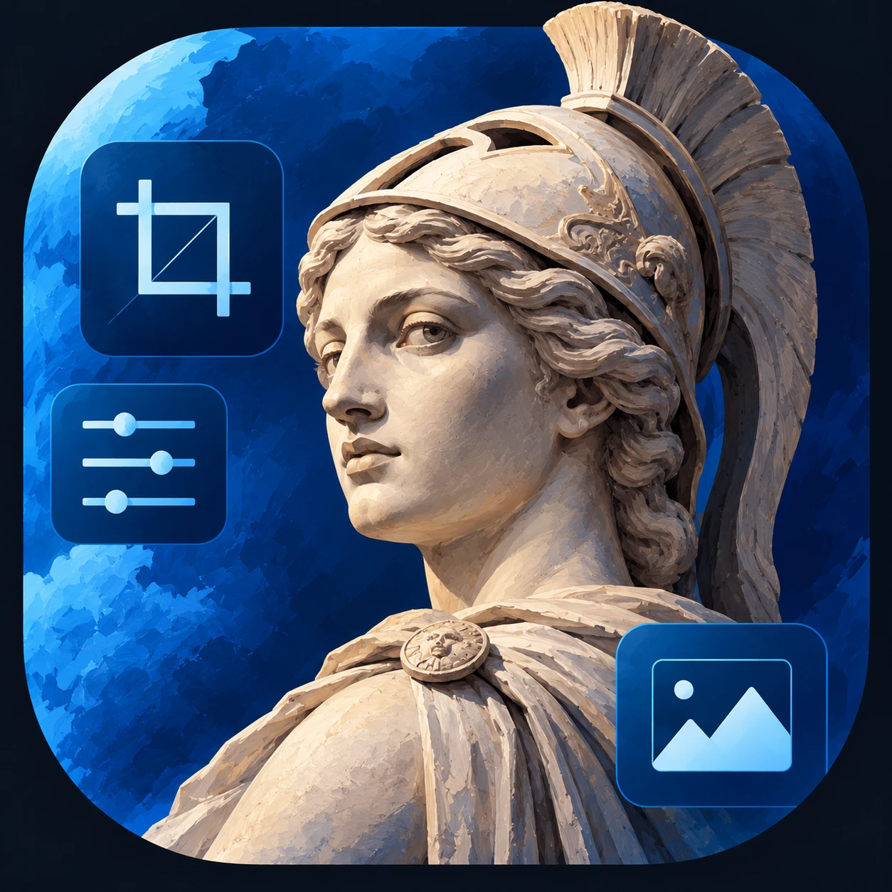
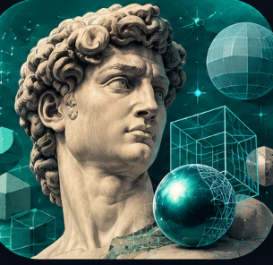
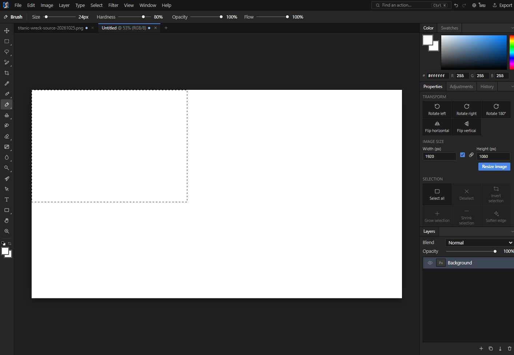

<div align="center">



# PhotoDesign

**A free, open-source photo editor.**

Layers, masks, adjustments, filters, brushes, type and PSD files in one dark workspace.
Every edit is a command, so the interface, the command line and AI agents share one engine.
Nothing is uploaded: your work stays on your computer.

[](https://github.com/plawanpawin-byte/PhotoDesign/releases)
&nbsp;
[](LICENSE-MIT)


</div>

## Our apps

<table>
  <tr>
    <th>App</th>
    <th>What it's for</th>
    <th>Code</th>
  </tr>
  <tr>
    <td align="center"><br/><b>lunaticDesign</b></td>
    <td>Vector illustration, photo editing and page layout</td>
    <td><a href="https://github.com/plawanpawin-byte/VectorEdit">GitHub</a></td>
  </tr>
  <tr>
    <td align="center"><br/><b>PhotoDesign</b> · <b>you are here</b></td>
    <td>Photo editing with layers, adjustments, filters and brushes</td>
    <td><a href="https://github.com/plawanpawin-byte/PhotoDesign">GitHub</a></td>
  </tr>
</table>

## What PhotoDesign is for

PhotoDesign is a desktop photo editor for Windows, built for people who edit photos and graphics
and want a free tool with no upload and no account. Use it to:

- **Retouch and adjust photos:** levels, curves, colour balance, brightness and contrast.
- **Work in layers:** raster and shape layers, masks, blend modes, opacity and layer styles.
- **Draw and paint:** brushes, the pencil and eraser, gradients and the paint bucket.
- **Make vector shapes and paths:** the Pen tool, Direct Selection and rectangle, ellipse and line tools.
- **Add text:** horizontal type with Thai and English, with fonts from your computer.
- **Open and save common formats:** PSD, PNG, JPEG, TIFF and more, so you can keep working on files from other editors.
- **Automate with an AI agent:** connect Claude Code, Codex or Antigravity to drive the open window (see below).

### Quick start

1. Download the installer from [Releases](https://github.com/plawanpawin-byte/PhotoDesign/releases) and run it.
2. Press **Ctrl+N** for a new document, or **Ctrl+O** to open a photo.
3. Pick a tool from the left-hand bar. Press **Ctrl+K** to search for any command by name.
4. Save with **Ctrl+S**, or export a copy with **Export**.

Every action is also a command in the engine, so anything you can do with the mouse can be scripted.

## Examples

<p align="center">
  
  
</p>

The sunset is made only from PhotoDesign's own layers, gradient fill and shapes.

## Status

Early work on top of the PhotoCraft base. Changes so far are listed in [CHANGES.md](CHANGES.md).

## Tools

<h4>🧰 40 tools</h4>
Move · Rectangular Marquee · Elliptical Marquee · Lasso · Magnetic Lasso · Quick Selection · Object Selection · Magic Wand · Crop · Eyedropper · Spot Healing Brush · Healing Brush · Patch · Red Eye · Brush · Pencil · Mixer Brush · Color Replacement · Clone Stamp · Pattern Stamp · History Brush · Eraser · Background Eraser · Magic Eraser · Gradient · Paint Bucket · Blur · Sharpen · Smudge · Dodge · Burn · Sponge · Pen · Direct Selection · Type · Rectangle · Ellipse · Line · Hand · Zoom

Every other engine action (filters, adjustments, slices, artboards and more) is a command: run it from the command finder (Ctrl+K) or from an AI agent.

## How it is built

| Part | Language | Where |
| --- | --- | --- |
| Interface: tools, panels, canvas, command finder, Thai and English | TypeScript | [`web/`](web/) |
| Desktop window | JavaScript (Electron) | [`desktop/`](desktop/) |
| Editing engine: documents, layers, brushes, filters, file formats, history | Rust | `crates/` |
| Bridge from the interface to the engine (WebAssembly) | Rust | [`apps/photodesign-wasm`](apps/photodesign-wasm) |
| Command line and agent (MCP) server | Rust | `apps/photocraft-cli`, `crates/automation` |

The interface is PhotoDesign's own design, not a copy of Photoshop's: a floating tool capsule, one
inspector card with Layers / Adjust / Image / History, a command finder (Ctrl+K) over every engine
action, a start screen with size presets, and a language switch (English, Thai). Every edit is an
engine command, so anything the interface does a script or an AI agent can do too.

The egui desktop interface inherited from PhotoCraft was removed; the engine did not depend on it.

## Install

Download `PhotoDesign-Setup-<version>.exe` (installer) or `PhotoDesign-Portable-<version>.exe` (runs
without installing) from the [Releases page](https://github.com/plawanpawin-byte/PhotoDesign/releases).
Neither needs Rust or Node.

## Connect an AI agent (MCP)

PhotoDesign can be driven by Claude Code, Codex, Antigravity and other MCP clients: they open images,
run any engine command, use the tools on the canvas, and read screenshots. The agent works on the
window you have open, and files stay inside `Documents\PhotoDesign`.

1. Install and start PhotoDesign (the agent talks to the open window).
2. Run this once in PowerShell. It finds PhotoDesign and adds it to every agent you have installed
   (Claude Code, Codex, Antigravity), keeping a `.bak` copy of each config it changes:

   ```powershell
   $exe = Get-ChildItem "$env:LOCALAPPDATA\Programs","$env:ProgramFiles" -Filter "PhotoDesign.exe" -Recurse -EA 0 | Select-Object -First 1 -ExpandProperty FullName; if ($exe) { & $exe --install-mcp } else { "PhotoDesign is not installed: use the installer, or from the source folder run: cd desktop; npm run connect" }
   ```

3. Restart the agent, then ask it to "list the photodesign tools".

Running from source instead of the installer: `cd desktop`, then `npm install`, `npm run cli` (builds the
MCP server) and `npm run connect`. If it stops with `EBUSY`, close PhotoDesign and your agent apps
and run it again. The other ways to connect (Claude Desktop, Cursor, a manual config) and the
full list of tools are in [`desktop/MCP.md`](desktop/MCP.md). Building the app from source is in
[`desktop/README.md`](desktop/README.md).

## Licence

MIT OR Apache-2.0 (see `LICENSE-MIT`, `LICENSE-APACHE`). Third-party material and its licences are
in `NOTICE` and `ATTRIBUTION.md`.

### Language share

`node scripts/lang-share.mjs` counts only the code written for PhotoDesign (the `web/` interface, the `desktop/` host and the `photodesign-wasm` bridge), not the PhotoCraft engine in `crates/`. The engine is about 19 MB of Rust and is reused as it is.
